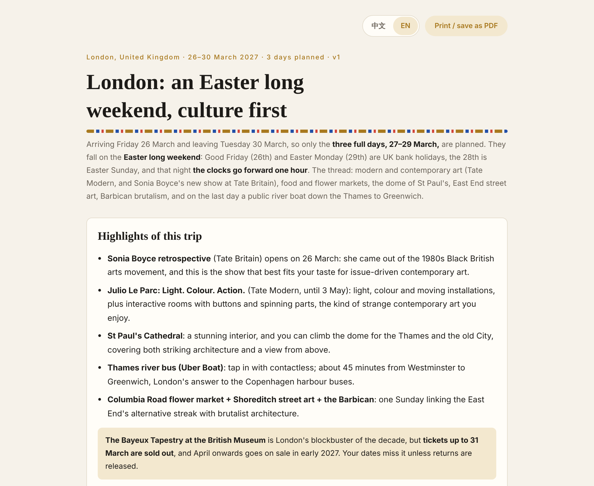
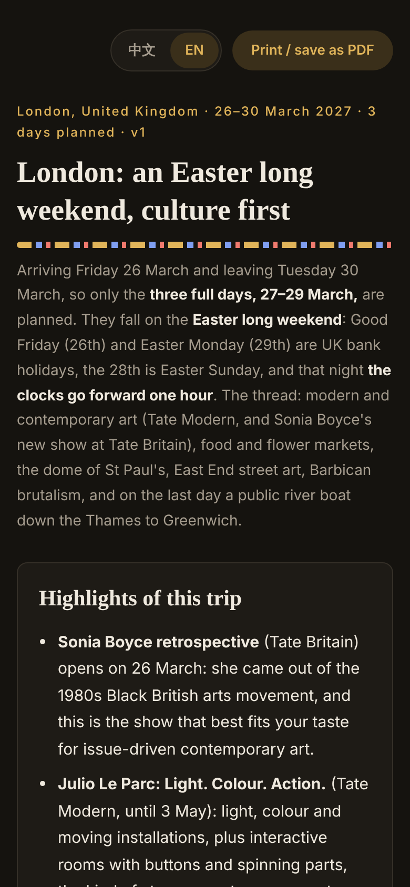

# Europe City Culture Planner

**English** · [中文](README.zh-CN.md)

**An AI-agent skill that plans culture-first days in a European city, the way a well-read local friend would.** Give it a city and your dates. It drops the arrival and departure days, then plans the full days in between. It starts from the city's official tourism site and its events calendar, then filters and adds places to fit your taste: contemporary art and what's on now, markets, striking architecture, hills and towers with a real view, ferries and vintage trams, alternative neighbourhoods, and themed free walking tours. It also checks big concerts and English stand-up on your dates and suggests films, books and documentaries about the place. You get one bilingual (中文 / English) page with a trip map, a timeline and a "book now" list.

It works with any AI agent that can browse the web: Claude, Claude Code, Cursor, Codex, ChatGPT, Gemini.

<p>
  
  
</p>

**Live example:** [London, Easter 2027](https://htmlpreview.github.io/?https://github.com/JialiNong/europe-city-culture-planner-skill/blob/main/europe-city-culture-planner/examples/london-2027-03.html) (the toggle at the top right switches between 中文 and English) · source data: [`london-2027-03.json`](europe-city-culture-planner/examples/london-2027-03.json)

---

## Why

Quick-tip travel feeds all list the same photo spots. I wanted something closer to how I actually enjoy cities. Here's what worked on my favourite trips:

- **Copenhagen:** I took the harbour bus one stop too far and ended up in a new canal district, with front doors opening onto private jetties. I saw every show at the Louisiana Museum of Modern Art. A "politically incorrect" free walking tour showed me the other side of the city.
- **Stockholm and Oslo:** public ferries out to dozens of islands, the metro-station art, and an open-air folk museum that is half farm, half old town.
- **Kraków and Budapest:** a river curving round the old town, church interiors that stop you in your tracks, vintage trams. But I missed Auschwitz because it books out weeks ahead.

The skill turns those lessons into a repeatable process: what to look for, where to look, which rules to apply, and what has to be booked early. Your own taste lives in [`profile.md`](europe-city-culture-planner/profile.md), so anyone can fork it and make it theirs.

## What it does

1. **Takes the dates and drops the travel days.** Arriving on the 26th and leaving on the 30th means the 27th, 28th and 29th get planned.
2. **Starts from the official tourism site** (visitlondon.com, visitstockholm.com…). It shortlists the classic sights, picks out events that fall on your dates, and checks whether a city card actually pays off.
3. **Fills the gaps by taste.** It searches current exhibitions at each museum (checking they cover your dates), styles close to artists you like (Klimt, Matisse in the default profile), markets, viewpoints, ferries and trams, new waterfront districts, alternative scenes and difficult-history sites. If the city alone isn't enough, it widens to places within 1 hour by train. Famous places further out, like Auschwitz from Kraków, are never filtered out.
4. **Finds top-rated free walking tours** on GuruWalk, Freetour.com and local operators. Themed tours get priority.
5. **Checks opening days, prices and booking.** It flags Monday closures, free days and timed entry, and sorts bookings into "book now / book soon / book later".
6. **Looks up big concerts and English stand-up** for the whole stay. It also notes shows that land a day or two outside your dates.
7. **Suggests films, books and documentaries** about the city that are available in Chinese or English.
8. **Plans each day by area**, at 3–5 stops a day: markets in the morning, viewpoints at sunset, and ferries and trams used to get between places. Each day gets a backup for rain.
9. **Writes the result as JSON** and renders it with a fixed template into one self-contained, bilingual HTML page.

## Design decisions

These are the choices that make it reliable rather than just a long prompt:

| Decision | Why |
|---|---|
| **The agent writes data, a fixed template renders the page** | The model only outputs JSON (validated against [`schema/city.schema.json`](europe-city-culture-planner/schema/city.schema.json)). That uses far fewer tokens than generating HTML, every page looks the same, and layout bugs are fixed once in [`template/render.js`](europe-city-culture-planner/template/render.js) instead of in every answer. |
| **Bilingual data model** | Any text field can be `"…"` or `{"zh": "…", "en": "…"}`. The renderer resolves the current language with a fallback. The toggle appears only when both languages exist, the choice persists in `localStorage`, and `?lang=en` deep-links. One file serves both audiences. |
| **Allowlisted HTML in text fields** | Text often comes from scraped pages. Fields marked as HTML keep only `<b> <i> <a> <br>`-style inline tags. Links must be `http(s)` and every attribute is stripped, so a hostile snippet can't run script in a page you share. |
| **Self-drawn SVG maps** | The trip map, day maps and timeline are drawn from coordinates in plain JS. They use an equirectangular projection with latitude correction, a scale bar and a north arrow, need no map library or tiles, and work offline and in print. |
| **Personal taste in `profile.md`, workflow in `SKILL.md`** | The process stays generic. Forking it for a different traveller means editing one file. |
| **Two zero-dependency renderers** | [`render.mjs`](europe-city-culture-planner/scripts/render.mjs) (Node 18+) and [`render.py`](europe-city-culture-planner/scripts/render.py) (stdlib only) produce byte-identical output. Both validate the JSON first, and they can run in sandboxes such as ChatGPT's code interpreter. |
| **Safety rules** | The agent never books or pays, never enters personal data and never bypasses captchas. Anything it can't verify is marked as such instead of being guessed. |

## Project structure

```
europe-city-culture-planner/     ← the skill itself (zip this folder to upload to Claude)
├── SKILL.md                     ← the workflow, steps 0–8 (written in Chinese; agents follow it in any language)
├── profile.md                   ← your taste and situation; edit this first
├── schema/city.schema.json      ← JSON format, including bilingual text fields
├── template/
│   ├── shell.html
│   ├── style.css                ← light/dark themes, phone layout, print styles
│   └── render.js                ← renders the JSON in the browser (i18n, sanitiser, maps)
├── scripts/
│   ├── render.mjs               ← JSON → standalone HTML (Node 18+, no dependencies)
│   └── render.py                ← same, Python 3 standard library only
└── examples/
    ├── london-2027-03.json      ← a real search, bilingual
    └── london-2027-03.html

AGENTS.md                        ← entry point for Cursor / Codex / Gemini CLI
CLAUDE.md                        ← entry point for Claude Code (imports AGENTS.md)
GEMINI.md                        ← entry point for Gemini CLI
.cursor/rules/                   ← Cursor rule
.claude/skills/                  ← Claude Code project skill (symlink to the skill folder)
```

## Set up your profile

Open [`europe-city-culture-planner/profile.md`](europe-city-culture-planner/profile.md) and replace it with your own taste. It currently holds the author's: contemporary and issue-driven art, Klimt and Matisse as style references, markets, striking architecture, viewpoints over characterful cityscapes, ferries and trams, alternative neighbourhoods, themed walking tours, big pop concerts and English stand-up, travelling without a car, and a Deutschlandticket. The agent reads this file before every plan.

## Usage

### Claude (claude.ai / desktop)

1. Zip the `europe-city-culture-planner/` folder (or run `npm run package`).
2. Upload the zip under **Settings → Skills**.
3. Say something like "London, 26–30 March 2027". Claude does the research and publishes the page as an Artifact.

### Claude Code

```bash
git clone https://github.com/JialiNong/europe-city-culture-planner-skill
cd europe-city-culture-planner-skill
claude
```

`.claude/skills/europe-city-culture-planner` is picked up as a project skill. To use it everywhere, copy the skill folder to `~/.claude/skills/`.

### Cursor / Codex / Gemini CLI

Open the repo: these agents read `AGENTS.md` automatically. Cursor also reads `.cursor/rules/`, and Gemini CLI reads `GEMINI.md`. Results go to `plans/<city>-<yyyy-mm>.json` and `.html`. The agent needs web access, ideally with a browser tool.

### ChatGPT / Gemini (web)

1. Upload `SKILL.md`, `profile.md`, `schema/city.schema.json` and `examples/london-2027-03.json`, or add them to a GPT or Gem as knowledge.
2. Turn on web search and ask it to output JSON that follows the schema.
3. With a code interpreter, also upload `scripts/render.py` and the three `template/` files, then run `python3 render.py plan.json`. Without one, render locally:

```bash
node europe-city-culture-planner/scripts/render.mjs plan.json
# or
python3 europe-city-culture-planner/scripts/render.py plan.json
```

## Bilingual pages

Write any text field once per language. Leave out `languages` or use plain strings for a single-language page, and the toggle disappears.

```json
{
  "languages": ["zh", "en"],
  "lang": "en",
  "title": { "zh": "伦敦文艺行程", "en": "London culture itinerary" },
  "days": [{
    "date": { "zh": "3 月 27 日 周六", "en": "Saturday 27 March" },
    "stops": [{ "time": "09:00", "name": "Borough Market", "cat": "market", "lat": 51.5055, "lng": -0.091 }]
  }]
}
```

## Notes

- Opening hours, prices and exhibition dates are a snapshot from when the search ran. Official sites are authoritative.
- The agent never books anything or fills in personal or payment details.
- `plans/` is git-ignored because your itineraries may contain personal details.

## Related skills

Three skills that work together for European trips by public transport:

| Skill | What it answers |
|---|---|
| [europe-route-finder](https://github.com/JialiNong/europe-route-finder-skill) | How do I get there cheaply? Hub expansion, hidden direct trains and night trains, real fares compared across operators. |
| [europe-town-stay-finder](https://github.com/JialiNong/europe-town-stay-finder-skill) | Where do I stay in a small town and its villages within 1 hour by transit, and what outdoor sports and hikes are nearby? |
| **europe-city-culture-planner** | What do I do with my days in a big city? |

## License

MIT
