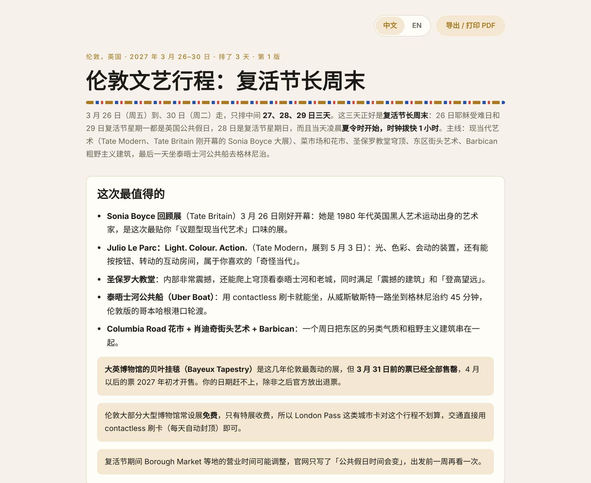
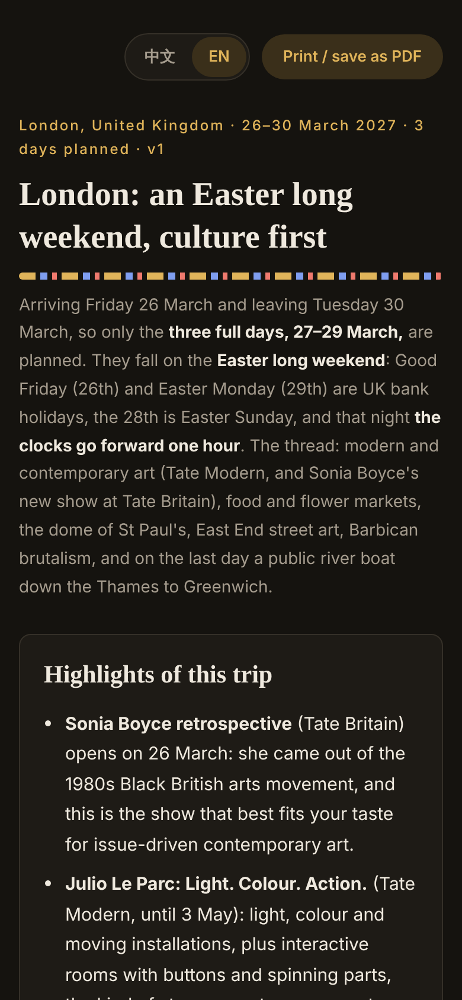

# Europe City Culture Planner · 欧洲城市文艺行程 skill

[English](README.md) · **中文**

**让 AI agent 像一个懂行的本地朋友那样，帮你排欧洲大城市的几天文艺行程。** 给它城市和日期，它会去掉到达日和离开日，只排中间的整天。它先看城市官方旅游网站推荐的经典地方和这几天的活动日历，再按你的口味筛选和补充：现当代艺术和这几天在展的展览、菜市场、震撼的建筑、能看到城市特色的登高点、轮渡和复古电车、另类街区、主题型 free walking tour。它还会查这几天的大型演唱会和英语脱口秀，推荐和当地有关的电影、书、纪录片。最后输出一张中英双语的页面，带行程总图、时间线和「需要提前订」清单。

适用于 Claude、Claude Code、Cursor、Codex、ChatGPT、Gemini 等能上网的 AI agent。

<p>
  
  
</p>

**在线示例**：[伦敦，2027 年复活节](https://htmlpreview.github.io/?https://github.com/JialiNong/europe-city-culture-planner-skill/blob/main/europe-city-culture-planner/examples/london-2027-03.html)（右上角可以切换中文 / English）· 数据：[`london-2027-03.json`](europe-city-culture-planner/examples/london-2027-03.json)

---

## 为什么需要它

小红书上的攻略太浅、太快，都是同一张打卡清单。我自己最满意的几次旅行，喜欢的其实是另一类东西：

- **哥本哈根**：坐港口轮渡不小心坐过了站，到了南边的运河新区，住宅楼下就是自家码头。我把 Louisiana 现代艺术馆的展全看完了。还跟了一个「政治不正确」主题的 free walking tour，看到这座城市的另一面。
- **斯德哥尔摩和奥斯陆**：公共轮渡能去几十个岛，还有地铁站里的艺术，以及农场和小镇结合在一起的露天博物馆。
- **克拉科夫和布达佩斯**：河绕着老城走，教堂内部很震撼，还有复古电车。可惜奥斯维辛要提前几周订，我没订上。

这个 skill 把这些经验写成固定流程：找什么、去哪找、按什么规则筛、哪些要提前订。个人口味单独放在 [`profile.md`](europe-city-culture-planner/profile.md)，别人 fork 之后改这一个文件就能变成自己的。

## 它会做什么

1. **确认日期，去掉头尾两天**：26 日到、30 日走，只排 27、28、29 日。
2. **先看官方旅游网站**（visitlondon.com、visitstockholm.com……）：经典推荐列成候选；活动日历筛出落在这几天的；城市卡算一下划不划算。
3. **按口味补充**：各馆官网的当期展览（核对展期），和你喜欢的艺术家风格相近的作品（默认 profile 里是 Klimt、Matisse），菜市场、登高点、轮渡电车、新式水岸街区、另类街区、沉重历史遗址。市区不够时扩大到火车 1 小时内；像克拉科夫的奥斯维辛这种很有名的，再远也不会过滤掉。
4. **高分 free walking tour**：GuruWalk、Freetour.com 和当地公司，主题型优先。
5. **核对开放时间和预订**：闭馆日、免费日、限时入场，按「马上订 / 尽快订 / 到时再订」分级。
6. **查这几天的大型演唱会和英语脱口秀**，差一两天的也会提一句。
7. **推荐电影、书、纪录片**：和当地历史文化有关，只推荐中文或英文能看的。
8. **按区域排每天的行程**：每天 3–5 个点，上午市场、傍晚登高，轮渡电车当作移动方式；每天都给一个下雨的备选。
9. **输出 JSON**，由固定模板渲染成一个独立的中英双语 HTML 页面。

## 设计上的几个决定

| 决定 | 原因 |
|---|---|
| **agent 只写数据，固定模板渲染页面** | 模型只输出 JSON（按 [`schema/city.schema.json`](europe-city-culture-planner/schema/city.schema.json) 校验），比让它写 HTML 省很多 token，页面每次一致；排版问题只需要在 [`template/render.js`](europe-city-culture-planner/template/render.js) 里改一次。 |
| **双语数据格式** | 任何文本字段都可以写 `"…"` 或 `{"zh": "…", "en": "…"}`。渲染时按当前语言取值，缺一种就退回另一种。两种语言都有才显示切换按钮，选择记在 `localStorage`，`?lang=en` 可以直接打开英文版。同一个文件两种读者都能看。 |
| **文本字段只保留白名单 HTML** | 内容常常来自网页。只保留 `<b> <i> <a> <br>` 这类行内标签，链接只允许 `http(s)`，属性全部去掉，发给别人的页面不会因为一段网页文字执行脚本。 |
| **自己画 SVG 地图** | 行程总图、每天的路线图和时间线都由坐标直接画出来（等距投影、按纬度修正，带比例尺和指北针），不用地图库和瓦片，离线和打印都能看。 |
| **口味放 `profile.md`，流程放 `SKILL.md`** | 流程保持通用，换一个人用只改一个文件。 |
| **两个零依赖的渲染脚本** | [`render.mjs`](europe-city-culture-planner/scripts/render.mjs)（Node 18+）和 [`render.py`](europe-city-culture-planner/scripts/render.py)（只用标准库）输出逐字节一致，都会先校验 JSON，也能在 ChatGPT 的代码解释器这类沙盒里跑。 |
| **安全规则** | 不下单、不付款、不填个人信息、不绕过验证码；查不到的写「未能查到」，不估。 |

## 项目结构

```
europe-city-culture-planner/     ← skill 本体（可以整个文件夹打包上传到 Claude）
├── SKILL.md                     ← 完整流程：第 0–8 步
├── profile.md                   ← 你的口味和固定情况，先改这个
├── schema/city.schema.json      ← JSON 格式（含双语字段）
├── template/
│   ├── shell.html
│   ├── style.css                ← 浅色/深色主题、手机适配、打印样式
│   └── render.js                ← 在浏览器里把 JSON 渲染成页面（双语、HTML 白名单、地图）
├── scripts/
│   ├── render.mjs               ← JSON → 独立 HTML（Node 18+，无依赖）
│   └── render.py                ← 同上（Python 3，只用标准库）
└── examples/
    ├── london-2027-03.json      ← 真实查询的结果，中英双语
    └── london-2027-03.html

AGENTS.md                        ← Cursor / Codex / Gemini CLI 等会自动读的入口
CLAUDE.md                        ← Claude Code 的入口（引用 AGENTS.md）
GEMINI.md                        ← Gemini CLI 的入口
.cursor/rules/                   ← Cursor 规则
.claude/skills/                  ← Claude Code 项目 skill（链接到 skill 文件夹）
```

## 先改个人设置

打开 [`europe-city-culture-planner/profile.md`](europe-city-culture-planner/profile.md)，换成你自己的口味。现在里面是作者的：现当代艺术和议题型展览、Klimt 和 Matisse 的风格参照、菜市场、震撼的建筑、看得到城市特色的登高点、轮渡和电车、另类街区、主题 free walking tour、大型流行演唱会和英语脱口秀，没有车，有 Deutschlandticket。agent 每次排行程前都会先读这个文件。

## 怎么用

### Claude（claude.ai / 桌面端）

1. 把 `europe-city-culture-planner/` 文件夹打成 zip（或运行 `npm run package`）。
2. 在 Claude 的 **设置 → Skills（技能）** 里上传。
3. 对 Claude 说：「伦敦，2027.03.26–03.30」。Claude 查完会把页面发布成 Artifact。

### Claude Code

```bash
git clone https://github.com/JialiNong/europe-city-culture-planner-skill
cd europe-city-culture-planner-skill
claude
```

仓库里的 `.claude/skills/europe-city-culture-planner` 会被识别为项目 skill。想在所有项目里都能用，把 skill 文件夹复制到 `~/.claude/skills/`。

### Cursor / Codex / Gemini CLI

用这个仓库打开项目即可：它们会自动读 `AGENTS.md`（Cursor 还会读 `.cursor/rules/`，Gemini CLI 读 `GEMINI.md`）。结果存到 `plans/<城市>-<年-月>.json` 和 `.html`。agent 需要能上网，最好有浏览器工具。

### ChatGPT / Gemini（网页版）

1. 把 `SKILL.md`、`profile.md`、`schema/city.schema.json`、`examples/london-2027-03.json` 上传到对话（或放进 GPT / Gem 的知识库）。
2. 打开联网搜索，让它查完后按 schema 输出 JSON。
3. 有代码解释器时，再上传 `scripts/render.py` 和 `template/` 里的三个文件，运行 `python3 render.py plan.json`；没有的话在本地渲染：

```bash
node europe-city-culture-planner/scripts/render.mjs plan.json
# 或
python3 europe-city-culture-planner/scripts/render.py plan.json
```

## 双语页面

每个文本字段按语言各写一份；只要一种语言时直接写字符串，页面就不显示切换按钮。

```json
{
  "languages": ["zh", "en"],
  "lang": "zh",
  "title": { "zh": "伦敦文艺行程", "en": "London culture itinerary" },
  "days": [{
    "date": { "zh": "3 月 27 日 周六", "en": "Saturday 27 March" },
    "stops": [{ "time": "09:00", "name": "Borough Market", "cat": "market", "lat": 51.5055, "lng": -0.091 }]
  }]
}
```

## 注意

- 开放时间、票价、展期都是查询时的快照，以官网为准。
- agent 不会替你下单，也不会填写任何个人或支付信息。
- `plans/` 默认不提交到 git，里面可能有你的行程信息。

## 相关 skill

三个配合使用的欧洲公共交通旅行 skill：

| Skill | 解决什么问题 |
|---|---|
| [europe-route-finder](https://github.com/JialiNong/europe-route-finder-skill) | 怎么去最省钱：扩展两端枢纽，找隐藏直达和夜车，对比各家真实票价 |
| [europe-town-stay-finder](https://github.com/JialiNong/europe-town-stay-finder-skill) | 去小镇住哪：小镇和公交 1 小时内的村子一起搜，附近的户外运动和徒步路线 |
| **europe-city-culture-planner** | 在大城市的几天怎么逛 |

## License

MIT
